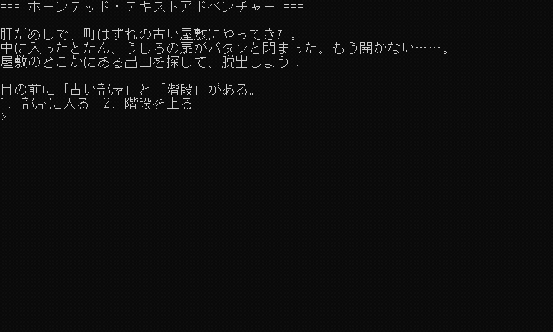

# ホーンテッド・テキストアドベンチャー

お化け屋敷から脱出を目指す、選択肢で進むテキストアドベンチャーです。<br>
番号を入力して Enter で選びます。



## 起動

動作環境は [サンプル集の README](../README.md#動作環境) を見てください。<br>
リポジトリの直下で、次のどちらかを実行します。

```sh
# Python版の場合
python 06_cli_games/01_text_adventure/python/main.py

# JavaScript版の場合
node 06_cli_games/01_text_adventure/javascript/main.js
```

## 講座との対応

ゲームループはありますが、入力を待つ形式のためリアルタイムなループではありません。<br>
最低限の要素を取り入れたゲームとなっています。

| 回    | しくみ       | このゲームでは                                                                            |
| ----- | ------------ | ----------------------------------------------------------------------------------------- |
| 第1回 | ゲームループ | `main()` の `while` で、入力 → 更新 → 描画 をくり返す                                     |
| 第3回 | 入力を待つ   | `read_input()` が `input()` で Enter まで待つ。選ぶまで世界は進まないので、待つ入力で十分 |
| 第4回 | ゲームの状態 | 「ゲームの状態」と「場所の状態」を 2 つの変数で持つ                                       |

## 実装内容

#### コードの流れ

`main()` のループ処理にて、入力 → 更新 → 描画 の流れで読んでいます。<br>
各関数もまとまりごとに分けているので、確認してみてください。

```python
draw_story()
draw(location, game_state)
while game_state == GAME_STATE_PLAYING:
    choice = read_input(location)                     # 入力
    location, game_state = update(location, choice)   # 更新
    draw(location, game_state)                        # 描画
```

| 関数           | やること                                                                                                                                                                                 |
| -------------- | ---------------------------------------------------------------------------------------------------------------------------------------------------------------------------------------- |
| `read_input()` | 選択肢のある場所（HALL・CORRIDOR）なら、1 か 2 が入力されるまで待って番号を返す。ほかの場所では待たずに空文字を返す                                                                      |
| `update()`     | 今の場所と番号から、次の場所とゲームの状態を返す。HALL と CORRIDOR の行き先は `update_hall()` / `update_corridor()` に任せる。ROOM・DOOR に着いたらゲームオーバー、EXIT に着いたらクリア |
| `draw()`       | 場所に合わせて `draw_hall()` などを呼び、文章を表示する。ゲームが終わっていれば `draw_game_over()` / `draw_game_clear()` も呼ぶ                                                          |

場所を増やすときは、`LOCATION_XXX` の定数と `draw_xxx()` を作って `draw()` に分岐を足し、`update()` にも行き先を足します。

#### ゲームの状態

今回のゲームでは「ゲーム状態(game_state)」と「場所(location)」の2つの状態を管理しています。<br>
各状態の種類は定数として定義しています。

| 変数         | 値（定数）                                                                                                      | 役割                     |
| ------------ | --------------------------------------------------------------------------------------------------------------- | ------------------------ |
| `game_state` | `GAME_STATE_PLAYING` / `GAME_STATE_GAME_OVER` / `GAME_STATE_GAME_CLEAR`                                         | ゲームを続けるか終わるか |
| `location`   | `LOCATION_HALL` / `LOCATION_ROOM` / `LOCATION_STAIRS` / `LOCATION_CORRIDOR` / `LOCATION_DOOR` / `LOCATION_EXIT` | 今どこにいるか           |

ループは `game_state` が `GAME_STATE_PLAYING` のあいだだけ回り、`location` によってやることが入れ替わります。

```text
HALL
 ├─ 1: ROOM ───────────────→ GAME OVER
 └─ 2: STAIRS → CORRIDOR
                 ├─ 1: DOOR → GAME OVER
                 └─ 2: EXIT → GAME CLEAR
```
