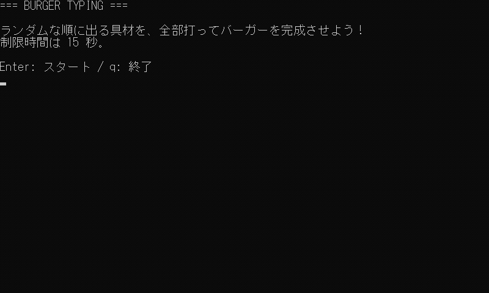

# バーガー・タイピング

画面に出るハンバーガーの具材を打って、バーガーを完成させるタイピングゲームです。<br>
15 秒以内に 6 つの具材を全部打てばクリア、時間切れでゲームオーバーです。



## 起動

動作環境は [サンプル集の README](../README.md#動作環境) を見てください。<br>
リポジトリの直下で、次のどちらかを実行します。

```sh
# Python版の場合
python 06_cli_games/02_burger_typing/python/main.py

# JavaScript版の場合
node 06_cli_games/02_burger_typing/javascript/main.js
```

Enter を押さずにキーを読むため、エディタの「出力」パネルなどではなく、通常のターミナルから起動してください。

| キー  | 動作                                         |
| ----- | -------------------------------------------- |
| Enter | スタート（タイトル画面）                     |
| r     | タイトルに戻る（クリア・ゲームオーバー画面） |
| q     | 終了（タイトル・クリア・ゲームオーバー画面） |

## 講座との対応

制限時間を管理するため、リアルタイムにループを回しています。<br>
それに伴いフレームの管理とデルタタイムの使用も必要です。<br>
第1回・第2回の「時計つきのループ」をより意識したゲームとなっています。

| 回    | しくみ                 | このゲームでは                                                                                                         |
| ----- | ---------------------- | ---------------------------------------------------------------------------------------------------------------------- |
| 第1回 | ゲームループ           | `main()` の `while` で、入力 → 更新 → 描画 をくり返す                                                                  |
| 第2回 | FPS とデルタタイム     | ループの始まりに時刻を測り、`delta_time`（前の周から何秒たったか）を出す。1/30 秒になるまで待って FPS を 30 にそろえる |
| 第2回 | 時間を数える           | 残り時間を `time_left -= delta_time` で減らす。回数ではなく時間で数えるので、どのパソコンでも 15 秒は 15 秒            |
| 第3回 | 毎フレーム見に行く入力 | `read_key()` は押されたキーがなければ空文字を返してすぐ戻る。打っていなくても残り時間が減り続ける                      |
| 第4回 | 状態の切り替え         | タイトル → プレイ中 → クリア / ゲームオーバー を `change_state()` で切り替える                                         |
| 第5回 | 乱数（シャッフル）     | `start_playing()` で `random.shuffle()` を使い、出題順を毎回変える                                                     |

## 実装内容

#### コードの流れ

`main()` のループ処理にて、入力 → 更新 → 描画 の流れで読んでいます。<br>
ホーンテッド・テキストアドベンチャーと異なり、入力を待たずに毎フレーム回り続ける「時計つきのループ」になっています。

```python
previous_time = time.perf_counter()
while game.is_running:
    current_time = time.perf_counter()
    delta_time = current_time - previous_time     # 前の周から何秒たったか
    previous_time = current_time                  # 次の周のために覚えておく

    key = read_key()                              # 入力
    update(game, key, delta_time)                 # 更新
    draw(game)                                    # 描画

    elapsed_time = time.perf_counter() - current_time
    time.sleep(max(0.0, 1 / FPS - elapsed_time))  # 1/FPS 秒になるまで待つ
```

| 関数         | やること                                                                                                                                                                      |
| ------------ | ----------------------------------------------------------------------------------------------------------------------------------------------------------------------------- |
| `read_key()` | 押されたキーを返す。押されていなければ待たずに空文字を返す（`terminal_input.py`）                                                                                             |
| `update()`   | ゲームの状態に合わせて `update_title()` / `update_playing()` / `update_result()` を呼ぶ。`update_playing()` は残り時間を減らし、打ったキーがお題の次の 1 文字と同じなら進める |
| `draw()`     | ゲームの状態に合わせて `draw_title()` などで画面を作り、見出しをつけて描き直す                                                                                                |

打った文字が正しいかは、打ったキーがお題の次の 1 文字（`word[len(typed_text)]`）と同じかだけで調べています。<br>
`draw_playing()` は最後の行（`入力: ...`）を改行で終えないので、描いたあとのカーソルが入力の横に残ります。

#### ゲームの状態

今回のゲームでは「ゲーム状態(game_state)」を、ゲーム全体のデータ `Game` の中に持っています。<br>
各状態の種類は、1 本目と同じく定数として定義しています。

| 値（定数）              | 画面           |
| ----------------------- | -------------- |
| `GAME_STATE_TITLE`      | タイトル画面   |
| `GAME_STATE_PLAYING`    | プレイ中       |
| `GAME_STATE_GAME_CLEAR` | ゲームクリア   |
| `GAME_STATE_GAME_OVER`  | ゲームオーバー |

状態は必ず `change_state()` を通して切り替えます。<br>
プレイ中に入るときだけ開始処理 `start_playing()` を呼び、出題順のシャッフルや残り時間のリセットを 1 回だけ行うので、r でもう一度遊んでも最初からやり直せます。

```text
TITLE → PLAYING ──6 つ打った──→ GAME_CLEAR
  ↑       　 └────時間切れ────→ GAME_OVER
  └────────────────────────────────┘
```

#### Enter を待たないキー入力

Python版の `terminal_input.py` は、Enter を待たずにキーを読むための補助スクリプトです。<br>
ゲーム側は `read_key()` を毎フレーム呼ぶだけで使えます。端末の準備は import したときに行い、元に戻すのはプログラムの終了時に自動で行います。

- Python 版: Windowsと macOS・Linuxで読み方を分けています
- JavaScript 版: キーは「届いたら呼ばれる関数」に届くので、届いたキーを順にためておき、`readKey()` が毎フレーム 1 つずつ取り出します
