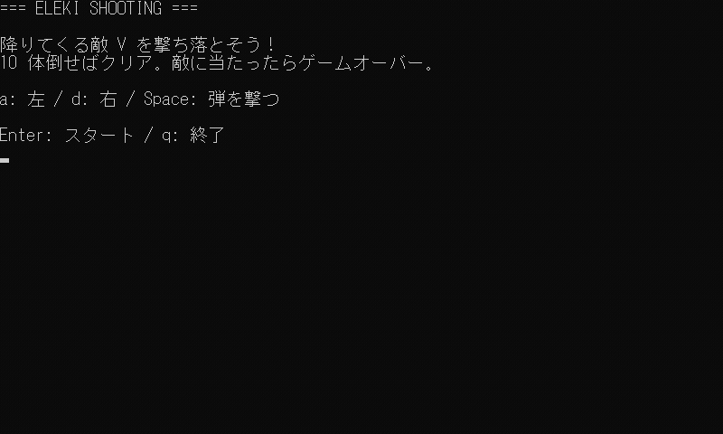

# CLI ゲームサンプル集

「ゲームのしくみ 基礎編」**第6回「CLI ゲーム制作」** で作る、小さな CLI ゲームのサンプル集です。

第1回〜第5回で見てきた仕組みを組み合わせた、3 本のゲームを用意しています。<br>
どのゲームも Python 版と JavaScript（Node.js）版を用意しており、内容は同じものです。

## ゲーム一覧

| #   | ゲーム                                                              | 内容                                                         | 主に使う仕組み                                         |
| --- | ------------------------------------------------------------------- | ------------------------------------------------------------ | ------------------------------------------------------ |
| 1   | [ホーンテッド・テキストアドベンチャー](01_text_adventure/README.md) | 選択肢を選んで、お化け屋敷から脱出する                       | ゲームループ・入力を待つ・ゲームの状態                 |
| 2   | [バーガー・タイピング](02_burger_typing/README.md)                  | ランダムに出る具材を打って、制限時間内にバーガーを完成させる | FPS とデルタタイム・待たない入力・状態の切り替え・乱数 |
| 3   | [エレキシューティング](03_eleki_shooting/README.md)                 | 降りてくる敵を撃ち落とす、リアルタイムのシューティング       | これまでの仕組みすべて                                 |

## 実行画面

各ゲームの実行画面になります。<br>
遊び方としくみの説明は、各ゲームの README にまとめています。

### ホーンテッド・テキストアドベンチャー

お化け屋敷から脱出を目指す、選択肢で進むテキストアドベンチャーです。


### バーガー・タイピング

制限時間内に 6 つの具材を入力して、バーガーを完成させます。


### エレキシューティング

左右に移動しながら弾を撃ち、敵を 10 体倒します。



## シリーズとの対応

| 回    | 仕組み                       |  1  |  2  |  3  |
| ----- | ---------------------------- | :-: | :-: | :-: |
| 第1回 | ゲームループ                 |  ○  |  ○  |  ○  |
| 第2回 | フレームレートとデルタタイム |     |  ○  |  ○  |
| 第3回 | 入力                         |  ○  |  ○  |  ○  |
| 第4回 | ゲームの状態                 |  ○  |  ○  |  ○  |
| 第5回 | 乱数                         |     |  ○  |  ○  |

## 動作環境

実行には、それぞれ以下のいずれかの環境が必要です。

- 実行環境
  - Python 版: Python 3.10 以降
  - JavaScript 版: Node.js 18 以降
- ターミナル
  - Windows Terminal / PowerShell
  - macOS・Linux の標準ターミナル

リポジトリの直下で、遊びたいゲームの `main.py`（Python 版）か `main.js`（JavaScript 版）を実行すると起動します。

```sh
# Python版
python 06_cli_games/01_text_adventure/python/main.py
python 06_cli_games/02_burger_typing/python/main.py
python 06_cli_games/03_eleki_shooting/python/main.py

# JavaScript版
node 06_cli_games/01_text_adventure/javascript/main.js
node 06_cli_games/02_burger_typing/javascript/main.js
node 06_cli_games/03_eleki_shooting/javascript/main.js
```

## フォルダ構成

各ゲームはフォルダ単体で完結しています。

```text
06_cli_games/
├─ README.md           # この説明
├─ code_guide.md       # コードの書き方の決まり
├─ 01_text_adventure/  # ホーンテッド・テキストアドベンチャー
│  ├─ README.md        # 遊び方としくみの説明
│  ├─ images/          # README の画像
│  ├─ python/          # Python 版（main.py）
│  └─ javascript/      # JavaScript 版（main.js）
├─ 02_burger_typing/   # バーガー・タイピング（同じ構成）
└─ 03_eleki_shooting/  # エレキシューティング（同じ構成）
```

コードの書き方の決まりは [code_guide.md](code_guide.md) にまとめています。
