# 3Dゲームサンプル集 (AI生成版)

「ゲームのしくみ 基礎編」第7回「AI で 3D 化」のサンプルです。<br>
Claude Code に以下のプロンプトで依頼して、[第6回の CLI ゲーム](../06_cli_games/README.md)を3D化したものです。<br>
ゲームのコアとなる部分は、各ゲームのmain.jsに記載されています。<br>
モデルなど見た目の部分の差異はあるものの、全体の流れや実装は意外と変わらないことが確認できるはずです。

```
// 実行したプロンプト

// 1回目
tools\lec-game-cli-example\game 配下の各ゲームを、そのままの仕様で3Dゲームとして遊べる形で作成してください。
Three.jsを使って、ブラウザ上でプレイできるようにしてください。
モデルはCubeを組み合わせた簡易モデルを作って再現してください。

// 2回目
このままだと遊びづらいので、各ゲームを起動するメニューを作ってほしい。
各ゲーム画面の中にもBackボタンを用意して、メニューに戻れるようにしてほしい。
```

※ プロンプトのパス（`tools\lec-game-cli-example\game`）は、作ったときの置き場所です。このリポジトリでは `06_cli_games/` にあたります。

## 起動

ゲームは JavaScript を別ファイル（`main.js` / `models.js`）に分けているため、ローカルサーバーから開きます（ファイルを直接開くと、ブラウザの制限で読み込めません）。<br>
リポジトリの直下（`how-games-work-ja/`）で次のコマンドを実行し、表示された URL（http://localhost:3000 など）をブラウザで開くとメニューが出ます。

```sh
npm run play-3d
```

メニューからゲームを選ぶ（1 / 2 / 3 キーでも可）と起動し、ゲーム画面の左上の「Back」でメニューに戻ります。<br>
Three.js は CDN（jsDelivr）から読み込むため、インターネット接続が必要です。

## ゲーム一覧

`06_cli_games/` の 3 本を、仕様（ゲームの状態・遷移・定数・キー操作・クリア条件）はそのままに、Three.js の 3D で遊べるようにしたものです。<br>
モデルはすべて Cube（`BoxGeometry`）を組み合わせて作っています。

| #   | ゲーム                               | 元のゲーム                                                                    |
| --- | ------------------------------------ | ----------------------------------------------------------------------------- |
| 1   | ホーンテッド・テキストアドベンチャー | [06_cli_games/01_text_adventure](../06_cli_games/01_text_adventure/README.md) |
| 2   | バーガー・タイピング                 | [06_cli_games/02_burger_typing](../06_cli_games/02_burger_typing/README.md)   |
| 3   | エレキシューティング                 | [06_cli_games/03_eleki_shooting](../06_cli_games/03_eleki_shooting/README.md) |

## 実行画面

#### メニュー

起動するとメニューが表示され、遊びたいゲームを選べます。

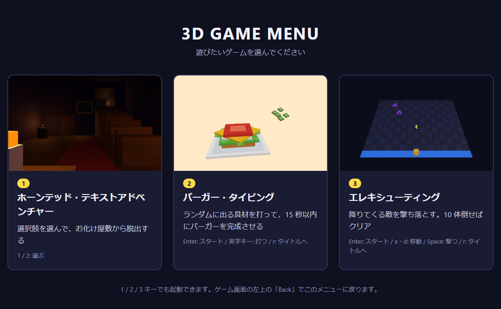

#### ホーンテッド・テキストアドベンチャー

洋館の中を 1 人称視点で進みます。選んだ選択肢に合わせてカメラが移動し、文章は画面下に CLI 版と同じ順に流れます。

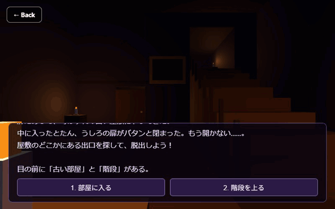

| エントランス（HALL）                                     | 廊下（CORRIDOR）                                   | 出口（GAME CLEAR）                               |
| -------------------------------------------------------- | -------------------------------------------------- | ------------------------------------------------ |
| 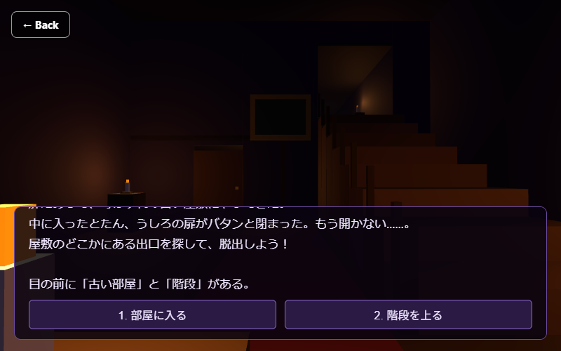 | 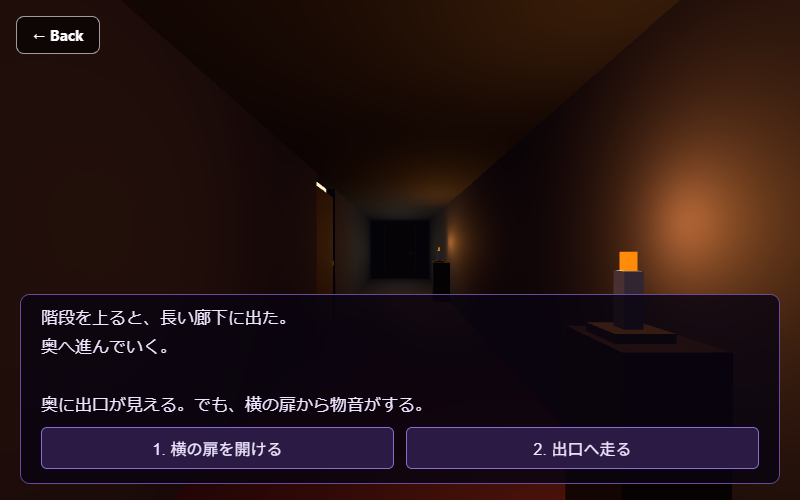 | 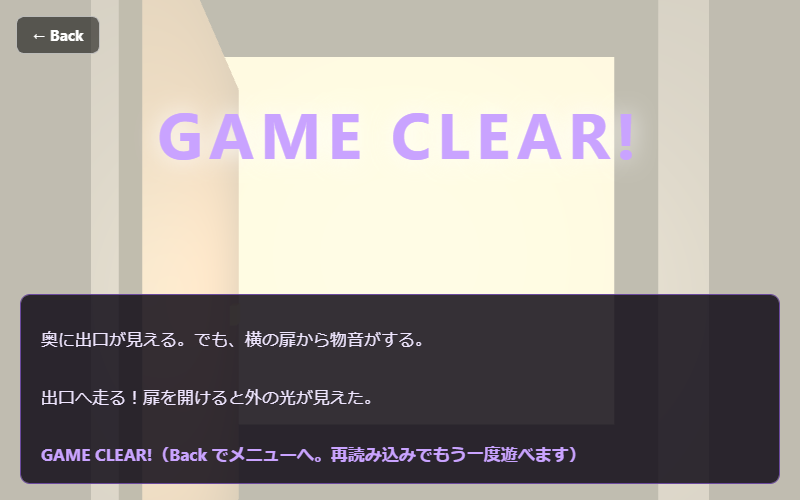 |

古い部屋に入ると、おばけが飛び出してきてゲームオーバーです。

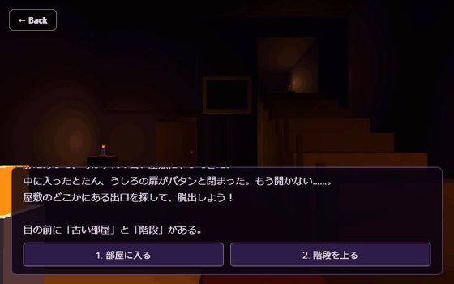

#### バーガー・タイピング

具材を 1 つ打ち終えるたびに、その具材が皿の上に落ちて積まれていきます。6 つ打つと上のバンズが乗って完成です。


| タイトル                                            | プレイ中                                              | クリア                                            |
| --------------------------------------------------- | ----------------------------------------------------- | ------------------------------------------------- |
| 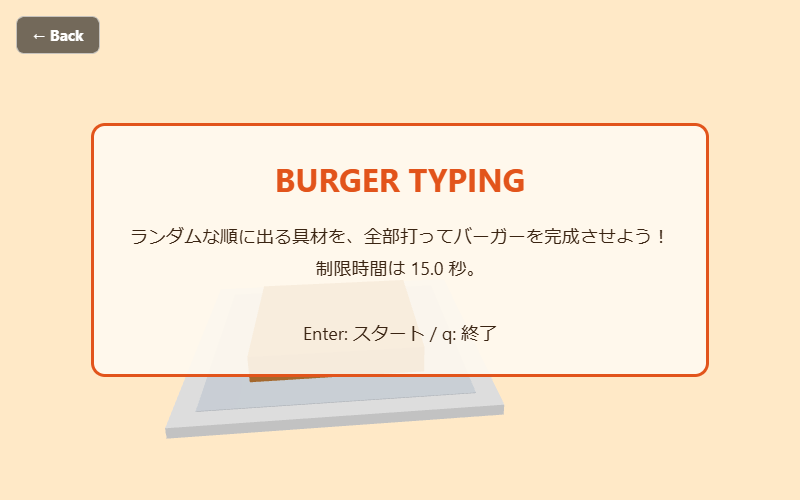 | 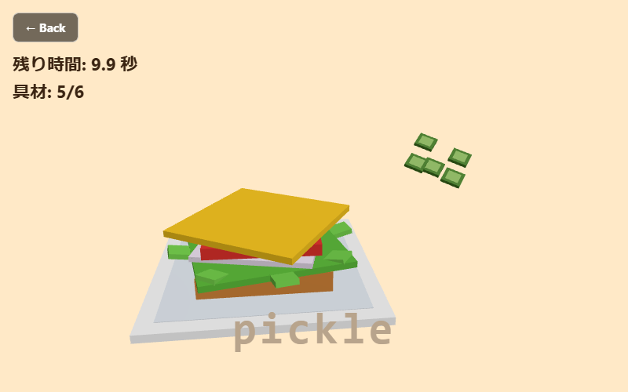 | 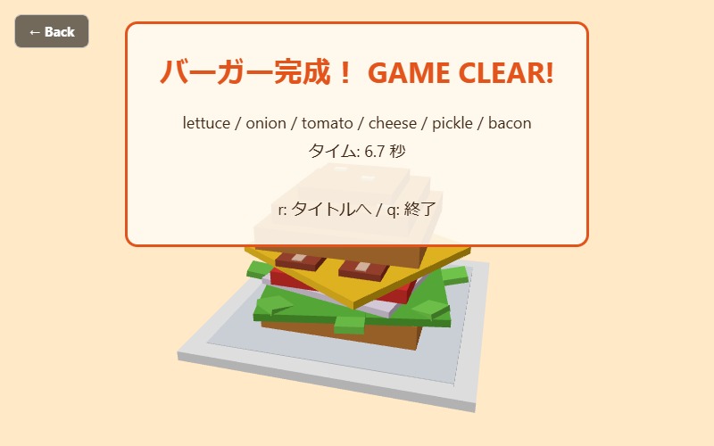 |

#### エレキシューティング

CLI 版と同じ 15 × 12 マスの盤面を、斜め上から見下ろします。敵を倒すと破片が飛び散ります。

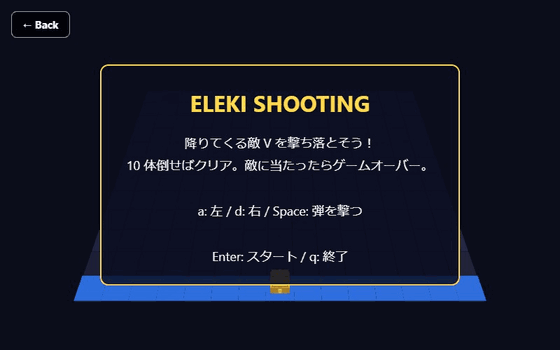

| タイトル                                             | プレイ中                                               | クリア                                             |
| ---------------------------------------------------- | ------------------------------------------------------ | -------------------------------------------------- |
| 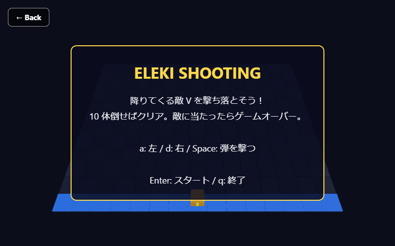 | 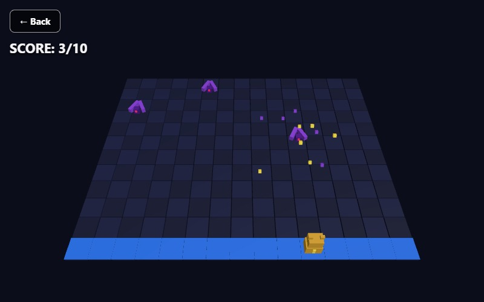 | 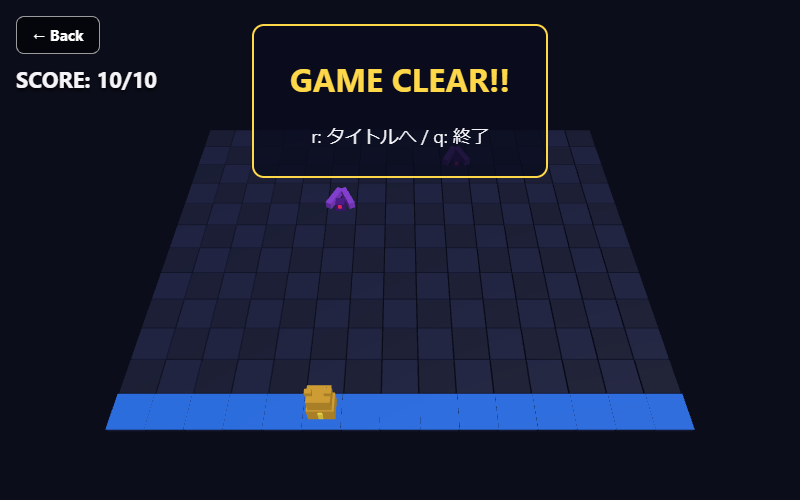 |

## フォルダ構成

各ゲームは「画面（HTML）」「ゲームの処理」「3D モデル」の 3 つのファイルに分けています。

```text
07_ai_3d_games/
├─ index.html            # メニュー
├─ images/               # メニューのサムネイル
├─ touch_controls.js     # スマホで遊ぶための画面のボタン（下の「スマホで遊ぶ」）
├─ touch_controls.css    # そのボタンの見た目
├─ screenshots/          # この README の画像（ゲームでは使わない）
├─ 01_text_adventure/
│  ├─ index.html         # 画面（文字の表示・Back ボタン）
│  ├─ main.js            # ゲームの処理（状態・入力・更新・描画・ゲームループ）
│  └─ models.js          # 3D モデル（Cube を組み合わせた屋敷・おばけ）
├─ 02_burger_typing/     # 同じ構成（models.js はバンズ・具材・皿）
└─ 03_eleki_shooting/    # 同じ構成（models.js は盤面・自機・敵・弾）
```

## 操作

ブラウザではタブを閉じられないため、`q` を押すと「終了しました」の画面になります（Back でメニューに戻れます）。

#### ホーンテッド・テキストアドベンチャー

| キー  | 動作                                           |
| ----- | ---------------------------------------------- |
| 1 / 2 | 選択肢を選ぶ（画面のボタンをクリックしても可） |

元のゲームと同じく、クリア・ゲームオーバーで終わります。もう一度遊ぶときは Back でメニューに戻るか、ページを再読み込みしてください。

#### バーガー・タイピング

| キー     | 動作                                         |
| -------- | -------------------------------------------- |
| Enter    | スタート（タイトル画面）                     |
| 英字キー | お題の具材を打つ                             |
| r        | タイトルに戻る（クリア・ゲームオーバー画面） |
| q        | 終了（タイトル・クリア・ゲームオーバー画面） |

#### エレキシューティング

| キー  | 動作                                         |
| ----- | -------------------------------------------- |
| Enter | スタート（タイトル画面）                     |
| a / d | 左 / 右に 1 マス移動                         |
| Space | 弾を撃つ                                     |
| r     | タイトルに戻る（クリア・ゲームオーバー画面） |
| q     | 終了（タイトル・クリア・ゲームオーバー画面） |

## スマホで遊ぶ

スマホなどタッチで操作する端末では、画面の下にキーの代わりのボタンが出るよう追加対応しています。<br>
バーガー・タイピングは、入力欄をタップするとキーボードが出るので、そのまま具材を打ちます。<br>
縦向き・横向きのどちらでも遊べます。

- `touch_controls.js`: ゲームはキーボードの keydown だけを読んでいるので、ボタンを押したときに同じ keydown を送る
- バーガー・タイピングの `main.js` の `TIME_LIMIT`: スマホは画面のキーボードで打ちにくいので、制限時間を 30 秒にする
- バーガー・タイピング、エレキシューティングの `main.js` の `draw()`: スマホでは、クリア・ゲームオーバーの表示を Back やスコアの下から出す
- 各ゲームの `main.js` の `fitScreen()`（バーガー・タイピング、エレキシューティング）: 縦長の画面では、左右が切れないようにカメラの画角を広げる
